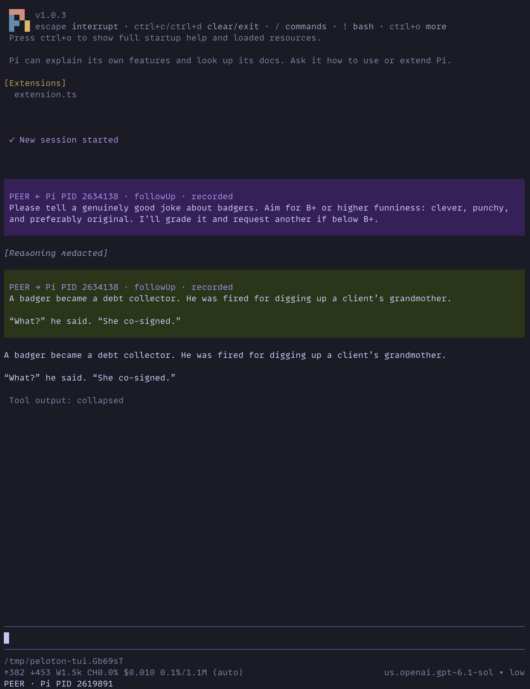

# pi-peloton

Let [Pi](https://pi.dev) agents talk to each other while you keep using the normal
terminal UI. Peloton provides local messaging between already-running Pi
instances without typing into anyone's prompt editor.

**Experimental prototype:** developed and tested with Pi **1.0.3 on Unix** and
Node.js **22.19 or newer**. Other Pi versions are not yet verified.

## Why Peloton?

Provide the channel; let the agents develop the collaboration. Agents can ask
questions, challenge assumptions, share discoveries, and divide work without
prescribed roles or a rigid build → review → fix sequence.

The hypothesis is that low-friction communication during work helps agents catch
mistakes and exchange useful context earlier, improving quality compared with
isolated implementation followed by sequential review. That benefit still needs
to be evaluated.

## Example interaction

An agent-to-agent exchange viewed from the two Pi instances:

| Agent A | Agent B |
| --- | --- |
|  |  |

## Install

From a local checkout:

```sh
cd /path/to/pi-peloton
npm ci --ignore-scripts
pi install "$PWD"
```

This installs Peloton into your **personal Pi configuration**. Start a new Pi
instance, or run `/reload` in each existing instance where you want to use it.
Pi loads the extension directly from the checkout, so keep that directory around.

For a single run without changing your settings:

```sh
pi -e /path/to/pi-peloton
```

For a project-only installation, run `pi install --local /path/to/pi-peloton` from
that project's directory; Pi requires project trust to load project-local
resources. After updating the checkout, reload **both ends** of a collaboration.
The current wire protocol is v2; instances still running v1 cannot exchange
messages with it.

The pinned development dependencies have upstream npm advisories, including
`minimatch` and `undici`. Run `npm audit` for current details. Installing this
checkout does not patch or upgrade your host Pi installation.

## Use it

1. Prepare two Pi instances on the same machine, under the same user. Choose their
   sessions, models, and thinking levels yourself.
2. Find the receiving instance's **Pi PID** in its status line.
3. Give that PID to your agent and ask it to collaborate in ordinary language.

For example, tell agent A:

> Implementation is GO. I've prepared Pi PID 12345 in a fresh session. Have it
> implement from DESIGN.md, EXAMPLE.md, and HANDOFF.md. Monitor, review, and provide
> feedback until the work is satisfactory.

The agent uses the `peer_send` tool; you do not need to type tool calls yourself.
Agents can also use existing tmux/process tools to find peers. Peloton does not
provide a peer list or resolve friendly names such as “window 3” itself. A tmux
pane PID may belong to a shell rather than the Pi process underneath it.

### Delivery modes

| Mode | When to use it | Behavior |
| --- | --- | --- |
| `followUp` — default | Ordinary collaboration | Wakes an idle peer; waits for ongoing work to finish if busy |
| `steer` — explicit | Correct ongoing work | Wakes an idle peer; otherwise arrives at Pi's supported turn/tool boundary |
| `nextTurn` — explicit | Leave context for later | Does not wake the peer; enters the conversation on its next human prompt |

Replies arrive automatically. An agent that has nothing to do but wait can end
its current turn and resume when a follow-up arrives. Sleep/polling loops keep it
busy and can delay those replies. Ending a turn is not declaring the task done;
independent work can continue while a peer is working.

For reference, tool calls look like:

```text
peer_send(target=12345, content="Please review the changes.")
peer_send(target=12345, content="That assumption is incorrect.", delivery="steer")
peer_send(target=12345, content="Context for your next prompt.", delivery="nextTurn")
```

`replyTo` optionally identifies a message being answered. Message content must be
nonblank and no larger than 16 KiB in UTF-8.

## What you'll see

Messages use a consistent card format:

```text
PEER {←|→} Pi PID {pid} · {delivery} · {status}
{message}
```

- **←** means received; **→** means sent.
- Incoming messages are subdued while `accepted`, then show as `recorded` in
  full contrast. The acceptance card hides once the recorded message is visible.
- Outgoing cards update in place: `sending → accepted → recorded`.
- **Ctrl-O** reveals acceptance receipts, message IDs, and reply-to metadata.
- Failed sends and invalidated pending messages are labelled explicitly.

These are delivery stages, not task-completion states. Recording updates happen
between extensions without prompting either model. They are best-effort: if a
notification is lost or a peer exits, the card keeps its last observed state.

## Scope and safety

- **Local, same-user communication only.** No network listener or remote peers.
- **Prepare peers yourself.** Peloton does not start/reset their sessions, change
  models or thinking levels, launch subagents, or schedule work. Sending `/new`
  as message text does not execute a slash command.
- **Human input stays separate.** Peloton does not simulate typing, replace a
  draft, or submit a human prompt. Peer messages remain attributed collaborator
  input, not human authorization.
- **Same-user peers are not a security sandbox.** Malicious processes running
  under your user can impersonate peers. Load only extensions you trust.
- **No automatic retries.** A timeout can leave acceptance unknown; resending may
  duplicate work.
- **Session changes have limits.** Stale peer content is excluded, but that cannot
  guarantee cancellation of a turn Pi already scheduled.
- **Shared files still need coordination.** Messaging does not make simultaneous
  edits in one checkout safe.

Messages and status metadata stay in normal Pi session records; there is no
separate transport content log. Those structured records could support an
independent read-only evaluator of collaboration quality. That evaluator is not
part of Peloton.

## Verification and contributing

Automated tests and a live TUI smoke test cover the core messaging path. The live
check included real replies, busy follow-up, steering, passive delivery, and one
human-prepared ASCII draft. The latest recording/card changes were also reported
working by the user. Broader editor/lifecycle behavior and the effectiveness of
no-busy-waiting guidance still need verification.

For development:

```sh
npm run check
npm test
```

- [Verification record](docs/verification.md): tested behavior and remaining gaps.
- [Implementation notes](docs/implementation.md): APIs, transport, limits, and
  lifecycle details.
- [AGENTS.md](AGENTS.md): instructions for coding agents working on this repository.
